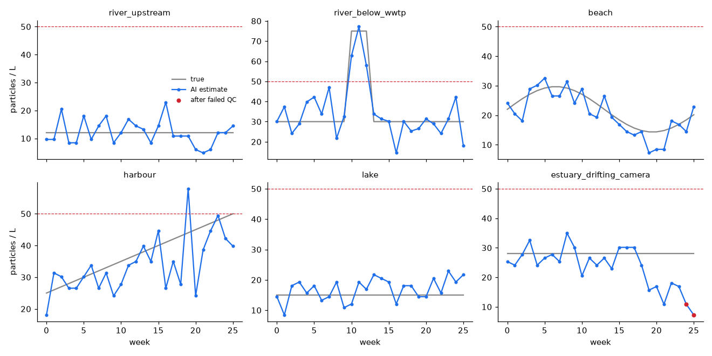

# Results

> Synthetic data. Every number below measures this pipeline on simulated filter images whose physics and spectra are assumptions (see README). These are not field measurements.

## 1. Detection and identification

| Model | Test water | Material acc. | Plastic precision | False-positive rate | Polymer ID acc. | Shape acc. | Particles found | Median count error |
|---|---|---:|---:|---:|---:|---:|---:|---:|
| trained on clean only | clean | 98.0 % | 97.3 % | 2.5 % | 100.0 % | 94.7 % | 79.2 % | 16.7 % |
| trained on clean only | turbid | 98.7 % | 99.7 % | 0.8 % | 99.0 % | 64.1 % | 82.9 % | 16.2 % |
| trained on clean only | weathered | 56.7 % | 100.0 % | 0.0 % | 96.7 % | 37.7 % | 14.7 % | 84.6 % |
| trained on clean+turbid+weathered | clean | 97.5 % | 96.3 % | 3.4 % | 99.3 % | 90.5 % | 79.8 % | 15.8 % |
| trained on clean+turbid+weathered | turbid | 98.7 % | 99.7 % | 0.8 % | 98.5 % | 90.9 % | 83.3 % | 14.8 % |
| trained on clean+turbid+weathered | weathered | 97.6 % | 98.8 % | 1.3 % | 97.9 % | 91.2 % | 79.6 % | 21.9 % |
| greyscale (no spectral bands) | clean | 66.4 % | 89.9 % | 9.2 % | 43.4 % | 85.8 % | 74.9 % | 13.3 % |
| greyscale (no spectral bands) | turbid | 58.7 % | 99.2 % | 2.4 % | 47.6 % | 89.2 % | 81.6 % | 16.2 % |
| greyscale (no spectral bands) | weathered | 66.9 % | 92.2 % | 7.8 % | 51.9 % | 87.0 % | 70.0 % | 24.2 % |
| self-training, 5 % labels | clean | 96.6 % | 96.3 % | 3.4 % | 97.2 % | 86.0 % | 80.1 % | 15.8 % |
| self-training, 5 % labels | turbid | 94.8 % | 99.7 % | 0.8 % | 93.7 % | 87.1 % | 83.1 % | 14.8 % |
| self-training, 5 % labels | weathered | 96.9 % | 98.2 % | 2.0 % | 97.9 % | 74.9 % | 79.4 % | 21.9 % |
| supervised, 5 % of images | clean | 95.4 % | 95.3 % | 4.3 % | 97.2 % | 80.1 % | 80.1 % | 15.4 % |
| supervised, 5 % of images | turbid | 96.7 % | 99.7 % | 0.8 % | 96.5 % | 83.8 % | 83.1 % | 14.8 % |
| supervised, 5 % of images | weathered | 94.0 % | 98.2 % | 2.0 % | 94.5 % | 73.2 % | 78.9 % | 19.0 % |

## 2. Where particles are lost: segmentation, not classification

| Filter loading | Got own segment | Found as plastic | <50 um | 50-100 um | 100-300 um | >300 um |
|---|---:|---:|---:|---:|---:|---:|
| dense (25-80 particles/field) | 80.1 % | 79.8 % | 75.6 % | 77.8 % | 83.9 % | 79.8 % |
| sparse (6-14 particles/field) | 91.2 % | 91.2 % | 82.4 % | 100.0 % | 96.0 % | 85.0 % |

Count calibration fitted on separate images: true = 1.21 x predicted +0.0. Median per-image count error, raw → calibrated: clean 15.8 % → 5.5 %; turbid 14.8 % → 8.4 %; weathered 21.9 % → 11.6 %.

Throughput: 0.49 s per 2 mm field (render excluded: segmentation + features + classification on one CPU).

## 3. Monitoring network (26 weekly samples per station)

Action level 50 particles/L (site-defined; there is no regulatory limit).

| Station | Mean true /L | Mean est. /L | Median est/true | Trend (Kendall p) | Hotspot | Alarms (correct / true exceedances) | QC recoveries | First QC fail |
|---|---:|---:|---:|---|---|---|---|---|
| river_upstream | 12.0 | 12.2 | 0.95 | none (0.534) |  | 0 (0/0) | 1.00, 1.00, 1.00, 1.00, 1.00, 1.00, 1.00 |  |
| river_below_wwtp | 35.2 | 34.7 | 1.00 | none (0.164) | yes | 3 (3/3) | 1.00, 1.00, 1.00, 1.00, 1.00, 1.00, 1.00 |  |
| beach | 22.0 | 20.5 | 0.91 | down (0.000) |  | 0 (0/0) | 1.00, 1.00, 1.00, 1.00, 1.00, 1.00, 1.00 |  |
| harbour | 37.5 | 33.9 | 0.93 | up (0.001) | yes | 1 (0/0) | 1.00, 1.00, 1.00, 1.00, 1.00, 1.00, 1.00 |  |
| lake | 15.0 | 16.9 | 1.21 | up (0.043) |  | 0 (0/0) | 1.00, 1.00, 1.00, 1.00, 1.00, 1.00, 1.00 |  |
| estuary_drifting_camera | 28.0 | 23.5 | 0.88 | down (0.003) |  | 0 (0/0) | 1.00, 1.00, 1.00, 1.00, 1.00, 1.00, 0.50 | 24 |

## 4. QC design: does the monthly reference check notice a drifting camera?

Drift step k = weeks since defocus began (blur 0.8 + 0.45k px, exposure −6 %/week). The real-sample column is plastics found ÷ true plastics on a typical environmental sample.

| k | blur px | bead reference recovery | bead+fibre reference recovery | real sample: found/true |
|---:|---:|---:|---:|---:|
| 0 | 1.25 | 100.0 % | 100.0 % | 81.1 % |
| 2 | 2.15 | 100.0 % | 100.0 % | 85.6 % |
| 4 | 3.05 | 100.0 % | 100.0 % | 78.9 % |
| 6 | 3.95 | 100.0 % | 100.0 % | 46.7 % |
| 8 | 4.85 | 96.0 % | 64.0 % | 35.6 % |
| 10 | 5.75 | 50.0 % | 2.0 % | 33.3 % |
| 12 | 6.65 | 50.0 % | 0.0 % | 37.8 % |

First step outside 80-120 %: bead reference k=10, bead+fibre reference k=8, real samples k=4.
